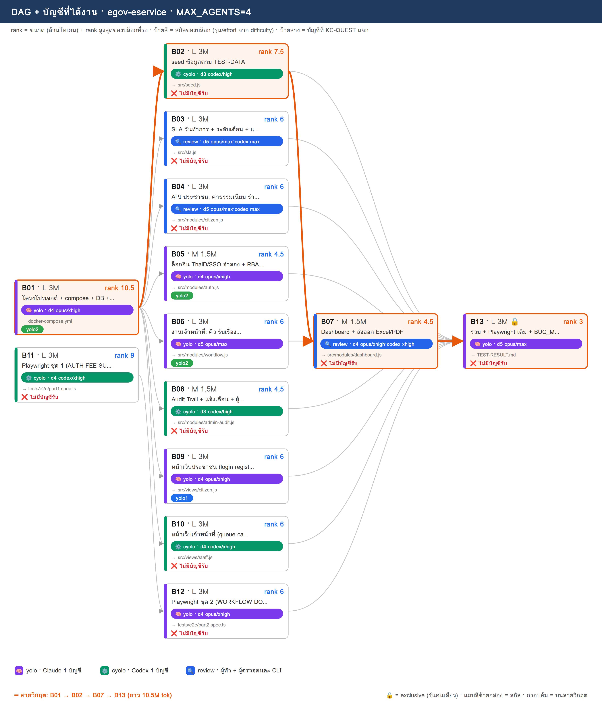
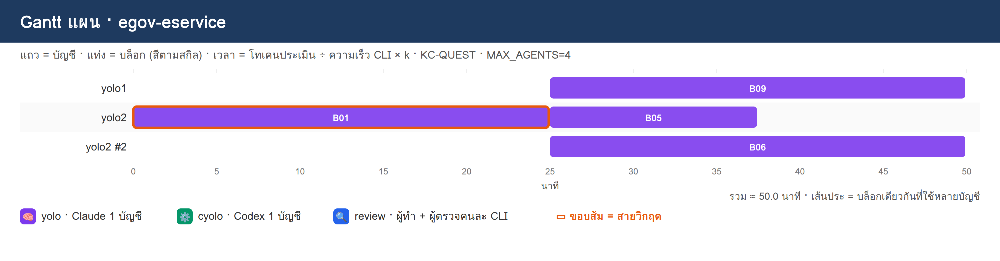

# PLAN · egov-eservice

**โจทย์:** เว็บ e-Service กลาง เทศบาลนครตัวอย่าง ตามชุดโจทย์ /workspace/egov-brief (อ่าน README.md ก่อน) ทำตาม REQUIREMENTS CONTRACT TEST-DATA DECISIONS ครบทุกข้อ (DECISIONS ข้อ 18 ใช้แทนถ้าขัดกัน) รันด้วย docker compose up คำสั่งเดียว รองรับ TEST_MODE=1 และ BUG_MODE ตาม BUGS.md มีชุด Playwright ครบ 51 TC ใน TEST-PLAN.md · stack: Node 20 + Express + SQLite (better-sqlite3, DB_PATH) + หน้า HTML ฝั่งเซิร์ฟเวอร์ · ห้ามแก้ไฟล์ใน /workspace/egov-brief · ห้ามใช้ชื่อ/ตราหน่วยงานจริง

วางแผนเมื่อ 16/11/2026 11:07 · MAX_AGENTS 4 · บัญชี cyolo1, cyolo2, yolo1, yolo2 · ตัวปรับเวลา k (ยังไม่มี calib.json → k=1)

> แผนนี้ยังไม่ได้รันจริง — KC-QUEST เลือกบัญชีจากโควตา แล้วจำลองเวลาตาม dependency

## 1) โควตาของแต่ละบัญชี

| บัญชี | แพลน | ใช้ไป 5 ชม. | ใช้ไปสัปดาห์ | headroom | รีเซ็ต/หมดอายุ (ชม.) | U | slot | ที่มา |
|---|---|---|---|---|---|---|---|---|
| cyolo1 | default | 10% | 0% | **90%** | 168.0 | 0.125 | 3 | สมมติ (--accounts) |
| cyolo2 | default | 30% | 0% | **70%** | 168.0 | 0.125 | 3 | สมมติ (--accounts) |
| yolo1 | default | 20% | 0% | **80%** | 168.0 | 0.125 | 3 | สมมติ (--accounts) |
| yolo2 | default | 40% | 0% | **60%** | 168.0 | 0.125 | 3 | สมมติ (--accounts) |

- ⚠ ทุกบัญชีเป็นค่าสมมติ (--accounts มี % ครบ) → ไม่ได้เรียก team.py check/quota

## 2) DAG + สกิล + บัญชี

**สายวิกฤต:** B01 → B02 → B07 → B13 · ยาว 10.5M tok

## 3) ตารางแจกงาน (เหตุผล KC-QUEST ทุกบล็อก)

| บล็อก | สกิล | ชื่อ | ขนาด · c | รอ | rank | บัญชี (บทบาท) | เริ่ม–จบ (นาที) | เหตุผล KC-QUEST |
|---|---|---|---|---|---|---|---|---|
| **B01** | 🧠 yolo | โครงโปรเจกต์ + compose + DB + test hook | L · 3 | – | 10.5 | yolo1 (ทำ) | 0.0–25.0 | ทำ: yolo1 31.0 (U=0.125 F=0.01 S=0.722 S=1.0 L=0.0) · 3.00M ≈ 5ชม. 7.8% / สัปดาห์ 0.98% · อันดับ 2 yolo2 28.0 |
| B11 | ⚙️ cyolo | Playwright ชุด 1 (AUTH FEE SUBMIT UPLOAD PAY QUEUE SLA NOTI) | L · 3 | – | 9 | cyolo1 (ทำ) | 0.0–37.5 | ทำ: cyolo1 26.5 (U=0.125 F=0.01 S=0.822 S=0.6 L=0.0) · 3.00M ≈ 5ชม. 7.8% / สัปดาห์ 0.98% · อันดับ 2 cyolo2 23.5 |
| **B02** | ⚙️ cyolo | seed ข้อมูลตาม TEST-DATA | L · 3 | B01 | 7.5 | cyolo2 (ทำ) | 25.0–62.5 | ทำ: cyolo2 22.0 (U=0.125 F=0.01 S=0.622 S=0.5 L=0.0) · 3.00M ≈ 5ชม. 7.8% / สัปดาห์ 0.98% · อันดับ 2 cyolo1 20.5 |
| B03 | 🔍 review | SLA วันทำการ + ระดับเตือน + แจ้งเตือน | L · 3 | B01 | 6 | yolo1 (ทำ), cyolo1 (ตรวจ) | 25.0–61.2 | ทำ: yolo1 23.4 (U=0.125 F=0.01 S=0.644 S=0.571 L=0.0) · 3.00M ≈ 5ชม. 7.8% / สัปดาห์ 0.98% · อันดับ 2 yolo2 21.6   ตรวจ: cyolo1 19.7 (U=0.125 F=0.003 S=0.799 S=0.4 L=0.333) · 0.90M ≈ 5ชม. 2.34% / สัปดาห์ 0.29% · อันดับ 2 cyolo2 16.7 |
| B06 | 🧠 yolo | งานเจ้าหน้าที่: คิว รับเรื่อง ตีกลับ อนุมัติ ออกเอกสาร | L · 3 | B01 | 6 | yolo2 (ทำ) | 37.5–62.5 | ทำ: yolo2 21.6 (U=0.125 F=0.01 S=0.522 S=0.571 L=0.0) · 3.00M ≈ 5ชม. 7.8% / สัปดาห์ 0.98% · อันดับ 2 yolo1 18.9 |
| B04 | 🔍 review | API ประชาชน: ค่าธรรมเนียม ร่าง อัปโหลด ชำระ QR | L · 3 | B01 | 6 | yolo1 (ทำ), cyolo1 (ตรวจ) | 61.2–97.5 | ทำ: yolo1 22.3 (U=0.125 F=0.01 S=0.566 S=0.571 L=0.0) · 3.00M ≈ 5ชม. 7.8% / สัปดาห์ 0.98% · อันดับ 2 yolo2 17.1   ตรวจ: cyolo1 22.7 (U=0.125 F=0.003 S=0.775 S=0.4 L=0.0) · 0.90M ≈ 5ชม. 2.34% / สัปดาห์ 0.29% · อันดับ 2 cyolo2 16.7 |
| B09 | 🧠 yolo | หน้าเว็บประชาชน (login register citizen new cases verify) | L · 3 | B01 | 6 | yolo2 (ทำ) | 62.5–87.5 | ทำ: yolo2 20.4 (U=0.125 F=0.01 S=0.444 S=0.571 L=0.0) · 3.00M ≈ 5ชม. 7.8% / สัปดาห์ 0.98% · อันดับ 2 yolo1 17.8 |
| B10 | ⚙️ cyolo | หน้าเว็บเจ้าหน้าที่ (queue cases approvals dashboard audit admin) | L · 3 | B01 | 6 | cyolo2 (ทำ) | 62.5–100.0 | ทำ: cyolo2 19.4 (U=0.125 F=0.01 S=0.544 S=0.4 L=0.0) · 3.00M ≈ 5ชม. 7.8% / สัปดาห์ 0.98% · อันดับ 2 cyolo1 18.3 |
| B12 | 🧠 yolo | Playwright ชุด 2 (WORKFLOW DOC PDPA DASH AUDIT RBAC NFR) | L · 3 | B11 | 6 | yolo2 (ทำ) | 87.5–112.5 | ทำ: yolo2 19.3 (U=0.125 F=0.01 S=0.366 S=0.571 L=0.0) · 3.00M ≈ 5ชม. 7.8% / สัปดาห์ 0.98% · อันดับ 2 yolo1 17.8 |
| B05 | 🧠 yolo | ล็อกอิน ThaiD/SSO จำลอง + RBAC + PDPA | M · 1.5 | B01 | 4.5 | yolo1 (ทำ) | 97.5–110.0 | ทำ: yolo1 19.4 (U=0.125 F=0.005 S=0.527 S=0.429 L=0.0) · 1.50M ≈ 5ชม. 3.9% / สัปดาห์ 0.49% · อันดับ 2 yolo2 13.1 |
| B08 | ⚙️ cyolo | Audit Trail + แจ้งเตือน + ผู้ดูแลระบบ | M · 1.5 | B01 | 4.5 | cyolo1 (ทำ) | 97.5–116.2 | ทำ: cyolo1 20.6 (U=0.125 F=0.005 S=0.736 S=0.3 L=0.0) · 1.50M ≈ 5ชม. 3.9% / สัปดาห์ 0.49% · อันดับ 2 cyolo2 13.8 |
| **B07** | 🔍 review | Dashboard + ส่งออก Excel/PDF | M · 1.5 | B02 | 4.5 | yolo1 (ทำ), cyolo2 (ตรวจ) | 110.0–128.1 | ทำ: yolo1 18.9 (U=0.125 F=0.005 S=0.488 S=0.429 L=0.0) · 1.50M ≈ 5ชม. 3.9% / สัปดาห์ 0.49% · อันดับ 2 yolo2 13.1   ตรวจ: cyolo2 17.5 (U=0.125 F=0.001 S=0.532 S=0.3 L=0.0) · 0.45M ≈ 5ชม. 1.17% / สัปดาห์ 0.15% · อันดับ 2 cyolo1 17.0 |
| **B13** | 🧠 yolo | รวม + Playwright เต็ม + BUG_MODE ทีละตัว | L · 3 | B02, B03, B04, B05, B06, B07, B08, B09, B10, B12 | 3 | yolo1 (ทำ) | 128.1–153.1 | ทำ: yolo1 15.6 (U=0.125 F=0.01 S=0.41 S=0.286 L=0.0) · 3.00M ≈ 5ชม. 7.8% / สัปดาห์ 0.98% · อันดับ 2 yolo2 13.8 |

## 4) Gantt แผน

## 5) รอบแจกงาน

| นาทีที่ | บล็อกที่เริ่ม |
|---|---|
| 0 | B01→yolo1, B11→cyolo1 |
| 25 | B02→cyolo2, B03→yolo1+cyolo1 |
| 37.5 | B06→yolo2 |
| 61.2 | B04→yolo1+cyolo1 |
| 62.5 | B09→yolo2, B10→cyolo2 |
| 87.5 | B12→yolo2 |
| 97.5 | B05→yolo1, B08→cyolo1 |
| 110 | B07→yolo1+cyolo2 |
| 128.1 | B13→yolo1 |

## 6) สรุป

- บล็อก 13 · แจกได้ 13 · agent พร้อมกันสูงสุด 4/4
- เวลาประมาณ 153.1 นาที (แท่ง Gantt) · ไฟล์ผลของทีม: `/workspace/plans/egov-eservice/app/`

ต่อไป: `dagplan.py export egov-eservice` → `dagplan.py run egov-eservice` → `dagplan.py report egov-eservice`
