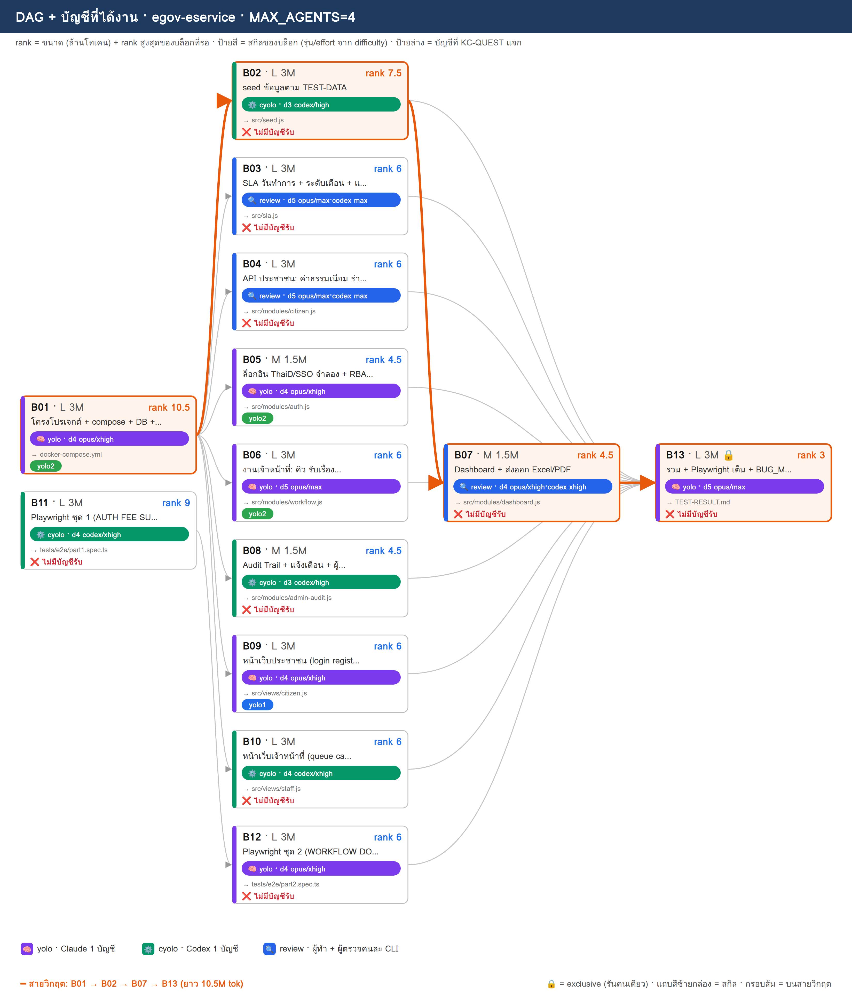
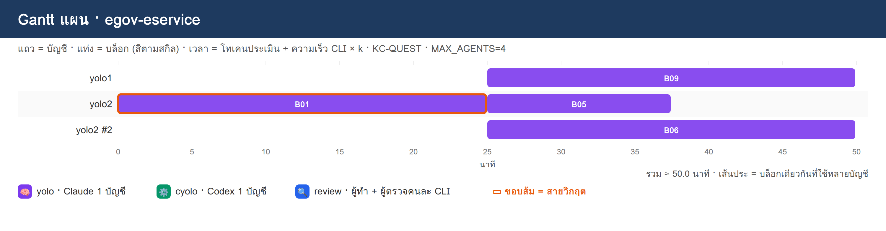

# PLAN · egov-eservice

**โจทย์:** เว็บ e-Service กลาง เทศบาลนครตัวอย่าง ตามชุดโจทย์ /workspace/egov-brief (อ่าน README.md ก่อน) ทำตาม REQUIREMENTS CONTRACT TEST-DATA DECISIONS ครบทุกข้อ (DECISIONS ข้อ 18 ใช้แทนถ้าขัดกัน) รันด้วย docker compose up คำสั่งเดียว รองรับ TEST_MODE=1 และ BUG_MODE ตาม BUGS.md มีชุด Playwright ครบ 51 TC ใน TEST-PLAN.md · stack: Node 20 + Express + SQLite (better-sqlite3, DB_PATH) + หน้า HTML ฝั่งเซิร์ฟเวอร์ · ห้ามแก้ไฟล์ใน /workspace/egov-brief · ห้ามใช้ชื่อ/ตราหน่วยงานจริง

วางแผนเมื่อ 16/11/2026 11:07 · MAX_AGENTS 4 · บัญชี yolo1, yolo2 · ตัวปรับเวลา k (ยังไม่มี calib.json → k=1)

> แผนนี้ยังไม่ได้รันจริง — KC-QUEST เลือกบัญชีจากโควตา แล้วจำลองเวลาตาม dependency

## 1) โควตาของแต่ละบัญชี

| บัญชี | แพลน | ใช้ไป 5 ชม. | ใช้ไปสัปดาห์ | headroom | รีเซ็ต/หมดอายุ (ชม.) | U | slot | ที่มา |
|---|---|---|---|---|---|---|---|---|
| yolo1 | default | 5% | 3% | **95%** | 117.9 | 0.169 | 3 | team.py quota |
| yolo2 | default | 5% | 0% | **95%** | 64.9 | 0.27 | 3 | team.py quota |

## 2) DAG + สกิล + บัญชี

**สายวิกฤต:** B01 → B02 → B07 → B13 · ยาว 10.5M tok

## 3) ตารางแจกงาน (เหตุผล KC-QUEST ทุกบล็อก)

| บล็อก | สกิล | ชื่อ | ขนาด · c | รอ | rank | บัญชี (บทบาท) | เริ่ม–จบ (นาที) | เหตุผล KC-QUEST |
|---|---|---|---|---|---|---|---|---|
| **B01** | 🧠 yolo | โครงโปรเจกต์ + compose + DB + test hook | L · 3 | – | 10.5 | yolo2 (ทำ) | 0.0–25.0 | ทำ: yolo2 39.1 (U=0.27 F=0.01 S=0.872 S=1.0 L=0.0) · 3.00M ≈ 5ชม. 7.8% / สัปดาห์ 0.98% · อันดับ 2 yolo1 35.0 |
| B06 | 🧠 yolo | งานเจ้าหน้าที่: คิว รับเรื่อง ตีกลับ อนุมัติ ออกเอกสาร | L · 3 | B01 | 6 | yolo2 (ทำ) | 25.0–50.0 | ทำ: yolo2 31.5 (U=0.27 F=0.01 S=0.794 S=0.571 L=0.0) · 3.00M ≈ 5ชม. 7.8% / สัปดาห์ 0.98% · อันดับ 2 yolo1 28.6 |
| B09 | 🧠 yolo | หน้าเว็บประชาชน (login register citizen new cases verify) | L · 3 | B01 | 6 | yolo1 (ทำ) | 25.0–50.0 | ทำ: yolo1 28.6 (U=0.169 F=0.01 S=0.872 S=0.571 L=0.0) · 3.00M ≈ 5ชม. 7.8% / สัปดาห์ 0.98% · อันดับ 2 yolo2 27.0 |
| B05 | 🧠 yolo | ล็อกอิน ThaiD/SSO จำลอง + RBAC + PDPA | M · 1.5 | B01 | 4.5 | yolo2 (ทำ) | 25.0–37.5 | ทำ: yolo2 25.3 (U=0.27 F=0.005 S=0.755 S=0.429 L=0.333) · 1.50M ≈ 5ชม. 3.9% / สัปดาห์ 0.49% · อันดับ 2 yolo1 22.5 |
| B11 | ⚙️ cyolo | Playwright ชุด 1 (AUTH FEE SUBMIT UPLOAD PAY QUEUE SLA NOTI) | L · 3 | – | 9 | ❌ | unassigned | ไม่มีบัญชีชุดไหนปิดบล็อกนี้ได้ (แบ่งให้เล็กลง / เพิ่มบัญชี / ลด n) |
| **B02** | ⚙️ cyolo | seed ข้อมูลตาม TEST-DATA | L · 3 | B01 | 7.5 | ❌ | unassigned | ไม่มีบัญชีชุดไหนปิดบล็อกนี้ได้ (แบ่งให้เล็กลง / เพิ่มบัญชี / ลด n) |
| B03 | 🔍 review | SLA วันทำการ + ระดับเตือน + แจ้งเตือน | L · 3 | B01 | 6 | ❌ | unassigned | ไม่มีบัญชีชุดไหนปิดบล็อกนี้ได้ (แบ่งให้เล็กลง / เพิ่มบัญชี / ลด n) |
| B04 | 🔍 review | API ประชาชน: ค่าธรรมเนียม ร่าง อัปโหลด ชำระ QR | L · 3 | B01 | 6 | ❌ | unassigned | ไม่มีบัญชีชุดไหนปิดบล็อกนี้ได้ (แบ่งให้เล็กลง / เพิ่มบัญชี / ลด n) |
| B10 | ⚙️ cyolo | หน้าเว็บเจ้าหน้าที่ (queue cases approvals dashboard audit admin) | L · 3 | B01 | 6 | ❌ | unassigned | ไม่มีบัญชีชุดไหนปิดบล็อกนี้ได้ (แบ่งให้เล็กลง / เพิ่มบัญชี / ลด n) |
| B12 | 🧠 yolo | Playwright ชุด 2 (WORKFLOW DOC PDPA DASH AUDIT RBAC NFR) | L · 3 | B11 | 6 | ❌ | blocked | รอบล็อกที่ไม่มีบัญชีรับ |
| **B07** | 🔍 review | Dashboard + ส่งออก Excel/PDF | M · 1.5 | B02 | 4.5 | ❌ | blocked | รอบล็อกที่ไม่มีบัญชีรับ |
| B08 | ⚙️ cyolo | Audit Trail + แจ้งเตือน + ผู้ดูแลระบบ | M · 1.5 | B01 | 4.5 | ❌ | unassigned | ไม่มีบัญชีชุดไหนปิดบล็อกนี้ได้ (แบ่งให้เล็กลง / เพิ่มบัญชี / ลด n) |
| **B13** | 🧠 yolo | รวม + Playwright เต็ม + BUG_MODE ทีละตัว | L · 3 | B02, B03, B04, B05, B06, B07, B08, B09, B10, B12 | 3 | ❌ | blocked | รอบล็อกที่ไม่มีบัญชีรับ |

## 4) Gantt แผน

## 5) รอบแจกงาน

| นาทีที่ | บล็อกที่เริ่ม |
|---|---|
| 0 | B01→yolo2 |
| 25 | B06→yolo2, B09→yolo1, B05→yolo2 |

## 6) สรุป

- บล็อก 13 · แจกได้ 4 · agent พร้อมกันสูงสุด 3/4
- เวลาประมาณ 50.0 นาที (แท่ง Gantt) · ไฟล์ผลของทีม: `/workspace/plans/egov-eservice/app/`
- ⚠ บล็อกที่ไม่มีบัญชีรับ: B02, B03, B04, B08, B10, B11, B07, B12, B13 → แบ่งให้เล็กลง / เพิ่มบัญชี / ลด n

ต่อไป: `dagplan.py export egov-eservice` → `dagplan.py run egov-eservice` → `dagplan.py report egov-eservice`
