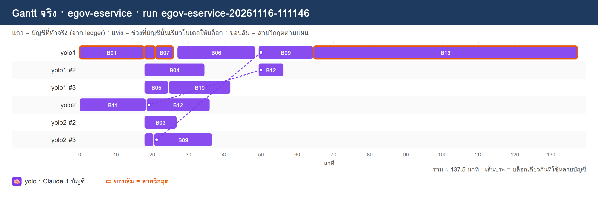
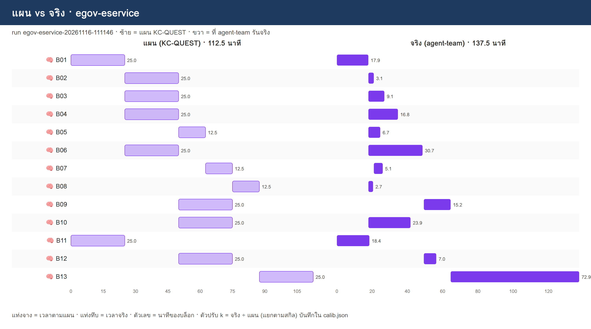

# REPORT · egov-eservice

**run:** `egov-eservice-20261116-111146` · `/workspace/.agent-team/egov-eservice-20261116-111146` · โจทย์: เว็บ e-Service กลาง เทศบาลนครตัวอย่าง ตามชุดโจทย์ /workspace/egov-brief (อ่าน README.md ก่อน) ทำตาม REQUIREMENTS CONTRACT TEST-DATA DECISIONS ครบทุกข้อ (DECISIONS ข้อ 18 ใช้แทนถ้าขัดกัน) รันด้วย docker compose up คำสั่งเดียว รองรับ TEST_MODE=1 และ BUG_MODE ตาม BUGS.md มีชุด Playwright ครบ 51 TC ใน TEST-PLAN.md · stack: Node 20 + Express + SQLite (better-sqlite3, DB_PATH) + หน้า HTML ฝั่งเซิร์ฟเวอร์ · ห้ามแก้ไฟล์ใน /workspace/egov-brief · ห้ามใช้ชื่อ/ตราหน่วยงานจริง

## ตารางบล็อก (แผน vs จริง)

| บล็อก | สกิล | บัญชีแผน | บัญชีจริง | นาทีแผน | นาทีจริง | tokens (ไม่รวม cache read) | ครั้ง | สถานะ | ไฟล์ผล |
|---|---|---|---|---|---|---|---|---|---|
| **B01** | 🧠 yolo | yolo2(ทำ) | yolo1(ทำ) | 25.00 | 17.87 | 336,295 | 1 | ok | ✅ docker-compose.yml |
| **B02** | 🧠 yolo | yolo2(ทำ) | yolo1(ทำ) | 25.00 | 3.07 | 127,031 | 1 | ok | ✅ src/seed.js |
| B03 | 🧠 yolo | yolo1(ทำ) | yolo2(ทำ) | 25.00 | 9.07 | 241,706 | 1 | ok | ✅ src/sla.js |
| B04 | 🧠 yolo | yolo2(ทำ) | yolo1(ทำ) | 25.00 | 16.75 | 457,393 | 1 | ok | ✅ src/modules/citizen.js |
| B05 | 🧠 yolo | yolo1(ทำ) | yolo1(ทำ) | 12.50 | 6.73 | 206,919 | 1 | ok | ✅ src/modules/auth.js |
| B06 | 🧠 yolo | yolo1(ทำ) | yolo1(ทำ) | 25.00 | 30.72 | 561,063 | 1 | ok | ✅ src/modules/workflow.js |
| **B07** | 🧠 yolo | yolo1(ทำ) | yolo1(ทำ) | 12.50 | 5.05 | 173,543 | 1 | ok | ✅ src/modules/dashboard.js |
| B08 | 🧠 yolo | yolo2(ทำ) | yolo2(ทำ) | 12.50 | 2.65 | 135,757 | 1 | ok | ✅ src/modules/admin-audit.js |
| B09 | 🧠 yolo | yolo2(ทำ) | yolo2(ทำ), yolo1(ทำ) | 25.00 | 15.20 | 585,237 | 2 | ok | ✅ src/views/citizen.js |
| B10 | 🧠 yolo | yolo1(ทำ) | yolo1(ทำ) | 25.00 | 23.90 | 420,091 | 1 | ok | ✅ src/views/staff.js |
| B11 | 🧠 yolo | yolo1(ทำ) | yolo2(ทำ) | 25.00 | 18.43 | 378,261 | 1 | ok | ✅ tests/e2e/part1.spec.ts |
| B12 | 🧠 yolo | yolo2(ทำ) | yolo2(ทำ), yolo1(ทำ) | 25.00 | 7.05 | 507,381 | 2 | ok | ✅ tests/e2e/part2.spec.ts |
| **B13** | 🧠 yolo | yolo2(ทำ) | yolo1(ทำ) | 25.00 | 72.92 | 429,670 | 1 | ok | ✅ TEST-RESULT.md |

- tokens รวมของบล็อก **4,560,347** = ผลรวมจาก ledger ของ run (15 การเรียก) **4,560,347** ✅ ตรงกัน
- การเรียกที่ไม่ใช่บล็อก (ตรวจความพร้อม ฯลฯ): 0 ครั้ง · 0 tokens (ไม่นับในตาราง)
- เวลารวม: แผน 112.5 นาที · จริง 137.5 นาที
- บล็อกเสร็จ 13/13

## ภาพ

## ความต่างระหว่างแผนกับของจริง

- B01: แผน yolo2(ทำ) → จริง yolo1(ทำ)
- B02: แผน yolo2(ทำ) → จริง yolo1(ทำ)
- B03: แผน yolo1(ทำ) → จริง yolo2(ทำ)
- B04: แผน yolo2(ทำ) → จริง yolo1(ทำ)
- B09: แผน yolo2(ทำ) → จริง yolo2(ทำ), yolo1(ทำ)
- B11: แผน yolo1(ทำ) → จริง yolo2(ทำ)
- B12: แผน yolo2(ทำ) → จริง yolo2(ทำ), yolo1(ทำ)
- B13: แผน yolo2(ทำ) → จริง yolo1(ทำ)
- (export ส่งเป็นฝั่ง yolo/cyolo ไม่ผูกบัญชี เพื่อให้ failover ของ agent-team ทำงาน → agent-team เลือกบัญชีในฝั่งเองตามโหลด/โควตา ดู references/run.md)
- event worker_stop:  → โควตา 81% ≥ เกณฑ์ 80%
- event worker_switch: B06 yolo2→yolo1 บัญชี yolo2 หยุดรับงาน: โควตา 81% ≥ เกณฑ์ 80%
- event worker_stop:  → โควตา 84% ≥ เกณฑ์ 80%

## ตัวปรับเวลา k (calib.json)

`/workspace/plans/calib.json`: {"yolo": 0.7979}

k = นาทีจริง ÷ นาทีแผน (ก่อนคูณ k) แยกตามสกิล · `plan` ครั้งถัดไปคูณเวลาแต่ละบล็อกด้วย k ของสกิลนั้น
