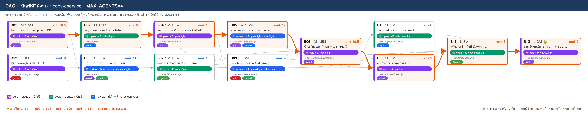
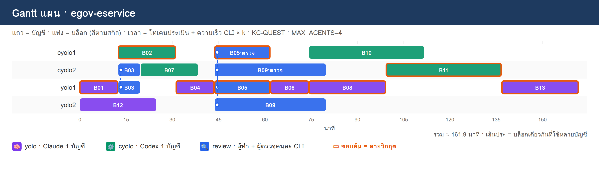

# PLAN · egov-eservice

**โจทย์:** สร้างเว็บ e-Service กลางตามชุดโจทย์ใน /workspace/egov-brief (อ่าน README.md ก่อน) ต้องทำตาม REQUIREMENTS.md CONTRACT.md TEST-DATA.md DECISIONS.md ครบทุกข้อ รันด้วย Docker Compose คำสั่งเดียว รองรับ TEST_MODE=1 และ BUG_MODE ตาม BUGS.md และมีชุด Playwright ครบทุก TC ใน TEST-PLAN.md

วางแผนเมื่อ 13/11/2026 11:06 · MAX_AGENTS 4 · บัญชี cyolo1, cyolo2, yolo1, yolo2 · ตัวปรับเวลา k (ยังไม่มี calib.json → k=1)

> แผนนี้ยังไม่ได้รันจริง — KC-QUEST เลือกบัญชีจากโควตา แล้วจำลองเวลาตาม dependency

## 1) โควตาของแต่ละบัญชี

| บัญชี | แพลน | ใช้ไป 5 ชม. | ใช้ไปสัปดาห์ | headroom | รีเซ็ต/หมดอายุ (ชม.) | U | slot | ที่มา |
|---|---|---|---|---|---|---|---|---|
| cyolo1 | default | 10% | 0% | **90%** | 168.0 | 0.125 | 3 | สมมติ (--accounts) |
| cyolo2 | default | 30% | 0% | **70%** | 168.0 | 0.125 | 3 | สมมติ (--accounts) |
| yolo1 | default | 20% | 0% | **80%** | 168.0 | 0.125 | 3 | สมมติ (--accounts) |
| yolo2 | default | 40% | 0% | **60%** | 168.0 | 0.125 | 3 | สมมติ (--accounts) |

- ⚠ ทุกบัญชีเป็นค่าสมมติ (--accounts มี % ครบ) → ไม่ได้เรียก team.py check/quota

## 2) DAG + สกิล + บัญชี

**สายวิกฤต:** B01 → B02 → B04 → B05 → B06 → B08 → B11 → B13 · ยาว 16.5M tok

## 3) ตารางแจกงาน (เหตุผล KC-QUEST ทุกบล็อก)

| บล็อก | สกิล | ชื่อ | ขนาด · c | รอ | rank | บัญชี (บทบาท) | เริ่ม–จบ (นาที) | เหตุผล KC-QUEST |
|---|---|---|---|---|---|---|---|---|
| **B01** | 🧠 yolo | โครงโปรเจกต์ + compose + DB + test hook | M · 1.5 | – | 16.5 | yolo1 (ทำ) | 0.0–12.5 | ทำ: yolo1 31.5 (U=0.125 F=0.005 S=0.761 S=1.0 L=0.0) · 1.50M ≈ 5ชม. 3.9% / สัปดาห์ 0.49% · อันดับ 2 yolo2 28.5 |
| B12 | 🧠 yolo | ชุด Playwright ครบ 51 TC | L · 3 | – | 6 | yolo2 (ทำ) | 0.0–25.0 | ทำ: yolo2 18.5 (U=0.125 F=0.01 S=0.522 S=0.364 L=0.0) · 3.00M ≈ 5ชม. 7.8% / สัปดาห์ 0.98% · อันดับ 2 yolo1 17.6 |
| **B02** | ⚙️ cyolo | ข้อมูล seed ตาม TEST-DATA | M · 1.5 | B01 | 15 | cyolo1 (ทำ) | 12.5–31.2 | ทำ: cyolo1 27.6 (U=0.125 F=0.005 S=0.861 S=0.636 L=0.0) · 1.50M ≈ 5ชม. 3.9% / สัปดาห์ 0.49% · อันดับ 2 cyolo2 24.6 |
| B03 | 🔍 review | ไลบรารีวันทำการ SLA และระดับเตือน | S · 0.6 | B01 | 11.1 | yolo1 (ทำ), cyolo2 (ตรวจ) | 12.5–19.7 | ทำ: yolo1 26.3 (U=0.125 F=0.002 S=0.745 S=0.673 L=0.0) · 0.60M ≈ 5ชม. 1.56% / สัปดาห์ 0.2% · อันดับ 2 cyolo2 22.4   ตรวจ: cyolo2 22.5 (U=0.125 F=0.001 S=0.695 S=0.471 L=0.0) · 0.18M ≈ 5ชม. 0.47% / สัปดาห์ 0.06% · อันดับ 2 cyolo1 21.6 |
| B07 | ⚙️ cyolo | เอกสารดิจิทัล ลายเซ็น PDF และหน้า verify | M · 1.5 | B03 | 10.5 | cyolo2 (ทำ) | 19.7–38.5 | ทำ: cyolo2 21.6 (U=0.125 F=0.005 S=0.656 S=0.445 L=0.0) · 1.50M ≈ 5ชม. 3.9% / สัปดาห์ 0.49% · อันดับ 2 cyolo1 20.8 |
| **B04** | 🧠 yolo | ล็อกอิน ThaiD/SSO จำลอง + RBAC | M · 1.5 | B01, B02 | 13.5 | yolo1 (ทำ) | 31.2–43.7 | ทำ: yolo1 28.0 (U=0.125 F=0.005 S=0.706 S=0.818 L=0.0) · 1.50M ≈ 5ชม. 3.9% / สัปดาห์ 0.49% · อันดับ 2 yolo2 24.6 |
| **B05** | 🔍 review | ค่าธรรมเนียม ร่าง และอัปโหลดไฟล์ | M · 1.5 | B01, B04 | 12 | yolo1 (ทำ), cyolo1 (ตรวจ) | 43.7–61.9 | ทำ: yolo1 26.0 (U=0.125 F=0.005 S=0.667 S=0.727 L=0.0) · 1.50M ≈ 5ชม. 3.9% / สัปดาห์ 0.49% · อันดับ 2 cyolo1 25.1   ตรวจ: cyolo1 25.4 (U=0.125 F=0.001 S=0.849 S=0.509 L=0.0) · 0.45M ≈ 5ชม. 1.17% / สัปดาห์ 0.15% · อันดับ 2 cyolo2 22.3 |
| B09 | 🔍 review | Dashboard ส่งออก Audit และผู้ดูแลระบบ | L · 3 | B02, B03, B04 | 9 | yolo2 (ทำ), cyolo2 (ตรวจ) | 43.7–80.0 | ทำ: yolo2 20.0 (U=0.125 F=0.01 S=0.444 S=0.545 L=0.0) · 3.00M ≈ 5ชม. 7.8% / สัปดาห์ 0.98% · อันดับ 2 cyolo2 19.6   ตรวจ: cyolo2 20.3 (U=0.125 F=0.003 S=0.633 S=0.382 L=0.0) · 0.90M ≈ 5ชม. 2.34% / สัปดาห์ 0.29% · อันดับ 2 cyolo1 19.8 |
| **B06** | 🧠 yolo | ชำระเงิน QR จำลอง + เลขคำขอ/ใบเสร็จ | M · 1.5 | B03, B05 | 10.5 | yolo1 (ทำ) | 61.9–74.4 | ทำ: yolo1 24.1 (U=0.125 F=0.005 S=0.628 S=0.636 L=0.0) · 1.50M ≈ 5ชม. 3.9% / สัปดาห์ 0.49% · อันดับ 2 yolo2 17.4 |
| **B08** | 🧠 yolo | คิว รับเรื่อง ตีกลับ ส่งต่อ อนุมัติ แจ้งเตือน | L · 3 | B04, B06, B07 | 9 | yolo1 (ทำ) | 74.4–99.4 | ทำ: yolo1 21.6 (U=0.125 F=0.01 S=0.55 S=0.545 L=0.0) · 3.00M ≈ 5ชม. 7.8% / สัปดาห์ 0.98% · อันดับ 2 yolo2 15.5 |
| B10 | ⚙️ cyolo | หน้าเว็บประชาชน + ล็อกอิน + ชำระเงิน | L · 3 | B04, B05, B06 | 6 | cyolo1 (ทำ) | 74.4–111.9 | ทำ: cyolo1 20.6 (U=0.125 F=0.01 S=0.771 S=0.255 L=0.0) · 3.00M ≈ 5ชม. 7.8% / สัปดาห์ 0.98% · อันดับ 2 cyolo2 14.0 |
| **B11** | ⚙️ cyolo | หน้าเว็บเจ้าหน้าที่ หัวหน้า ผู้บริหาร ผู้ตรวจ ผู้ดูแล | L · 3 | B08, B09 | 6 | cyolo2 (ทำ) | 99.4–136.9 | ทำ: cyolo2 17.4 (U=0.125 F=0.01 S=0.555 S=0.255 L=0.0) · 3.00M ≈ 5ชม. 7.8% / สัปดาห์ 0.98% · อันดับ 2 cyolo1 16.1 |
| **B13** | 🧠 yolo | รวม รันชุดเต็ม 51 TC และ BUG_MODE ทีละตัว | L · 3 | B10, B11, B12 | 3 | yolo1 (ทำ) | 136.9–161.9 | ทำ: yolo1 15.0 (U=0.125 F=0.01 S=0.472 S=0.182 L=0.0) · 3.00M ≈ 5ชม. 7.8% / สัปดาห์ 0.98% · อันดับ 2 yolo2 13.4 |

## 4) Gantt แผน

## 5) รอบแจกงาน

| นาทีที่ | บล็อกที่เริ่ม |
|---|---|
| 0 | B01→yolo1, B12→yolo2 |
| 12.5 | B02→cyolo1, B03→yolo1+cyolo2 |
| 19.7 | B07→cyolo2 |
| 31.2 | B04→yolo1 |
| 43.7 | B05→yolo1+cyolo1, B09→yolo2+cyolo2 |
| 61.9 | B06→yolo1 |
| 74.4 | B08→yolo1, B10→cyolo1 |
| 99.4 | B11→cyolo2 |
| 136.9 | B13→yolo1 |

## 6) สรุป

- บล็อก 13 · แจกได้ 13 · agent พร้อมกันสูงสุด 4/4
- เวลาประมาณ 161.9 นาที (แท่ง Gantt) · ไฟล์ผลของทีม: `/workspace/plans/egov-eservice/app/`

ต่อไป: `dagplan.py export egov-eservice` → `dagplan.py run egov-eservice` → `dagplan.py report egov-eservice`
