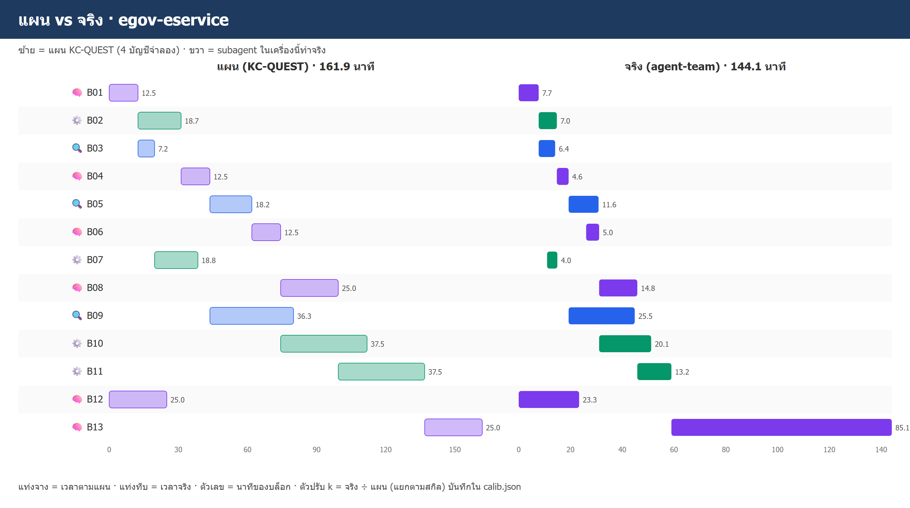
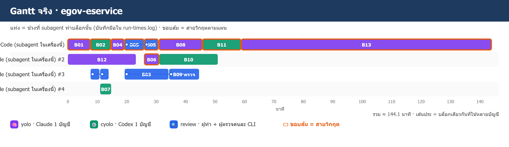
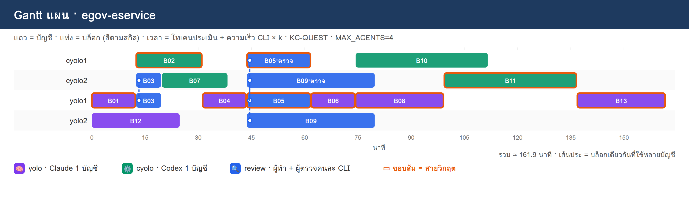

# REPORT · แผน vs จริง · egov-eservice (LAB 3)

 · แผน: 

## ต้องอ่านก่อน: "จริง" ในรายงานนี้คืออะไร

- แผน (PLAN.md) ทำด้วย `dag-planner` โดยใช้ **โควตาจำลอง** 4 บัญชี (`--accounts yolo1:80,yolo2:60,cyolo1:90,cyolo2:70`) เพราะตอนทำมีบัญชีที่ login จริงแค่ yolo1/yolo2 และไม่มี Codex
- งานจริงถูกสร้างด้วย **subagent ของ Claude Code ในเครื่องนี้ ตาม DAG เดียวกัน** (ผู้ใช้เลือกแบบนี้) ไม่ได้รันผ่าน `dagplan.py run` ใน container จึง **ไม่มี ledger / token จาก agent-team** และเวลา "จริง" มาจาก `run-times.log` ที่บันทึกด้วยมือตอนแต่ละบล็อกเริ่ม/จบ (นับเป็นวินาทีจาก T0 = 11:37:25)
- คอลัมน์สกิล `yolo`/`cyolo` ในแผนไม่ได้ถูกใช้แยกบัญชีจริง ทุกบล็อกทำโดยโมเดลตัวเดียวกัน บล็อกที่แผนระบุ `review` มี **agent ตรวจแยก** ที่คำนวณค่าจากโจทย์เอง (ไม่ดูจากโค้ด) แล้วรัน BUG_MODE

## ตารางบล็อก (นาที)

| บล็อก | งาน | แผน | จริง | หมายเหตุ |
|---|---|---|---|---|
| B01 | โครงโปรเจกต์ + compose + DB + test hook | 12.5 | 7.7 | |
| B02 | seed | 18.7 | 7.0 | |
| B03 | SLA (ทำ + ตรวจ) | 7.2 | 6.4 | agent ตรวจ approved |
| B04 | auth + RBAC | 12.5 | 4.6 | |
| B05 | ค่าธรรมเนียม/ร่าง/อัปโหลด (ทำ + ตรวจ) | 18.2 | 11.6 | ตรวจพบ LOW 1 ข้อ (500 เมื่อ serviceId ไม่ใช่ string) แก้แล้ว |
| B06 | ชำระเงิน | 12.5 | 5.0 | |
| B07 | เอกสารดิจิทัล + verify | 18.8 | 4.0 | |
| B08 | คิว/ตีกลับ/อนุมัติ/แจ้งเตือน | 25.0 | 14.8 | |
| B09 | dashboard/audit/admin (ทำ + ตรวจ) | 36.3 | 25.5 | ส่วนตรวจใช้เวลานานสุด (ทำ 15 นาที + ตรวจ 10 นาที) agent ตรวจ approved |
| B10 | หน้าเว็บประชาชน | 37.5 | 20.1 | |
| B11 | หน้าเว็บเจ้าหน้าที่ | 37.5 | 13.2 | |
| B12 | Playwright 51 TC | 25.0 | 23.3 | เริ่มพร้อม B01 ไม่พึ่งใคร |
| B13 | รวม + รันชุดเต็ม + BUG_MODE | 25.0 | **85.1** | ดูด้านล่าง |
| **รวมตามนาฬิกา** | | **161.9** | **144.1** | |

## อ่านตัวเลขอย่างไร (ไม่ใช่ "เร็วกว่าแผน 11%")

- **บล็อก B01–B12 จริงสั้นกว่าแผนทุกบล็อก** (ผลรวมเวลาของบล็อกเหล่านี้: แผน 261.7 นาที · จริง 143.2 นาที) แต่เป็นการเทียบแอปเปิลกับส้ม: แผนคิดจากโควตาของบัญชีจำลองและ `k = 1` (ยังไม่เคยปรับตัวเลขจากการรันจริง) ส่วนจริงคือ subagent ตัวเดียวกันที่ไม่ติดโควตา
- **B13 ใช้ 85.1 นาที vs แผน 25** ตัวเลขนี้ **ไม่ใช่เวลาของงานบล็อกล้วน** แยกตามเวลาใน log (ประมาณ):
  - 12:36–12:45 (~8.5 นาที) รันชุดเต็มครั้งแรก จำแนก 3 TC ที่ล้ม และแก้ จนผ่าน 51/51 สองรอบ
  - 12:45–13:14 (~29.6 นาที) BUG_MODE 15 รอบ (`test-report/bughunt-run.log`) รอบละ ~2 นาที
  - 13:14–14:01 (~47 นาที) จำแนกผลที่ไม่ตรงแผน (B03/NOTI-02, B08), แก้ assert + รันซ้ำ, ทำกราฟ/รายงาน และเวลาที่รอคำสั่ง/การตอบจากผู้ใช้ระหว่างทาง (แยกไม่ได้ เพราะไม่ได้จับเวลาแยก)
  - หมายเหตุ: บรรทัด `B13 end` ใน `run-times.log` บันทึกตอนสร้างกราฟ งาน GIF, Docker และ sweep รอบ 2 ที่ทำหลังจากนั้นไม่ได้นับรวมในตัวเลขนี้
- ช่วงที่ทำงานแบบขนานจริงสูงสุดคือ 3 บล็อกพร้อมกัน (ต่ำกว่า MAX_AGENTS 4 ที่แผนอนุญาต) เพราะ B12 จบที่นาทีที่ 23.3 และสายวิกฤตส่วนใหญ่เป็นลำดับ

## ที่แผนไม่ได้คาดไว้ (บทเรียน)

1. **สัญญากลาง (ARCHITECTURE.md) ต้องเขียนก่อนเริ่มบล็อกขนาน** ไม่เช่นนั้นไฟล์ที่ B01 เป็นเจ้าของ (`index.js`) จะถูกแก้ชนกัน ใช้ `routes/*.js` + `pages/*.js` ที่โหลดอัตโนมัติจึงไม่มีบล็อกไหนแก้ไฟล์ของบล็อกอื่น
2. **selftest ของบล็อกต้นทางเปราะเมื่อบล็อกถัดไปเติม seed** (B01 selftest ล้มหลัง B02: `5 !== 0`) → เปลี่ยนเป็นเทียบ snapshot หลัง reset
3. **ชุดเทสต์เขียนก่อนเว็บ (B12 ไม่พึ่งใคร)** ได้ผลดี: รันครั้งแรกกับเว็บจริงล้ม 3/51 ซึ่งจำแนกได้ว่า test ผิด 2 (NFR-01 race, UPLOAD-01 ใช้ `.map(testFile)` ผิด) web ผิด 1 (SUBMIT-01 คอลัมน์ผู้ถือเรื่อง) ไม่ได้แก้ผลที่คาดหวังตามหน้าจอเลย
4. พอร์ต 3000 ในเครื่องถูกโปรเซสอื่นใช้อยู่ จึงรันเว็บที่พอร์ต 3111 (compose ยัง map 3000 ตามโจทย์ เปลี่ยนด้วยตัวแปร)
5. เวลา "จริง" ใช้นาฬิกาติดผนังบันทึกมือ ไม่มี ledger จึงเทียบ token ไม่ได้ ถ้าต้องการต้องรันผ่าน `dagplan.py run` ใน container ที่ login ครบ

## ไฟล์ที่เกี่ยวข้อง

`blocks.json` · `PLAN.md` · `dag.png` · `gantt-plan.png` · `run-times.log` · `gantt-actual.png` · `compare.png` · `test-report/` (RESULT.md, BUG-HUNT.md)
