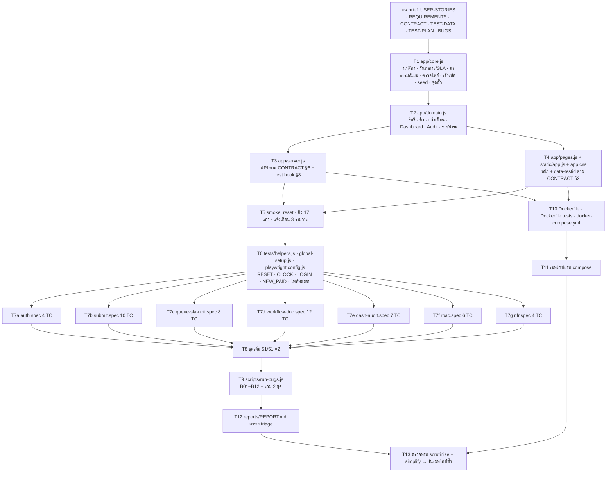

# แผนงานแบบ DAG (README §2 ขั้น 1)

> `dag-planner` / `agent-team` ของรายวิชาไม่มีในเครื่องนี้ จึงแตกงานเองตามลำดับเดียวกัน · กราฟนี้คือการแบ่งงานที่ใช้จริง (ทำเสร็จตามลำดับนี้)

| งาน | ขึ้นกับ | ไฟล์ที่แตะ | ชนกับ (ห้ามทำขนานกัน) |
|---|---|---|---|
| T1 core | อ่าน brief | `app/core.js` | – |
| T2 domain | T1 | `app/domain.js` | – |
| T3 API | T2 | `app/server.js` | T4 ใช้ชื่อ error/รูปแบบ JSON เดียวกัน (ตกลงผ่าน CONTRACT §5–6) |
| T4 หน้าเว็บ | T2 | `app/pages.js` `app/static/*` | T3 (เรียก API) |
| T6 test infra | T3 T4 | `tests/helpers.js` `tests/global-setup.js` `playwright.config.js` | ทุก spec |
| T7a–g spec | T6 | `tests/*.spec.js` (คนละไฟล์) | ขนานกันได้ แต่ **รันได้ทีละ worker** เพราะใช้ state เซิร์ฟเวอร์ร่วม (reset ต้น TC) |
| T9 bug runner | T8 | `scripts/run-bugs.js` | – |
| T10 docker | T3 T4 | `Dockerfile*` `docker-compose.yml` `.dockerignore` | – |

จุดเสี่ยงที่วางไว้ในแผน: (1) บั๊กต้องอยู่ฝั่งเซิร์ฟเวอร์และกระทบเฉพาะจุด → ใส่ใน T1–T3 เท่านั้น ไม่ใส่ใน test · (2) ค่าคาดหวังใน T7 มาจากตาราง TEST-PLAN/TEST-DATA ไม่อ่านจากหน้าจอ · (3) เวลาอ่านจากนาฬิกาทดสอบเท่านั้น (T1)
